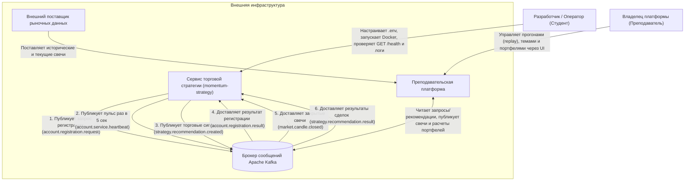
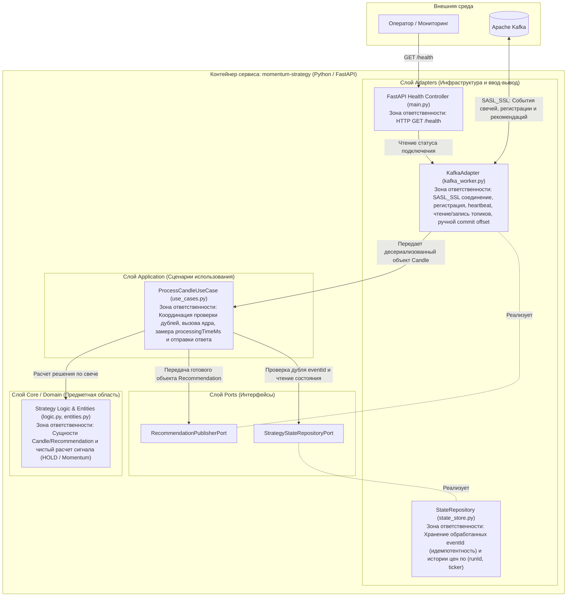

# Архитектурные схемы сервиса (C4 Model)

## 1. Контекстная схема (System Context)
Схема отражает место сервиса торговой стратегии в окружении платформы, пользователей и внешних систем, а также направление и назначение каждого взаимодействия.

---

## 2. Крупноузловая компонентная схема (Component Diagram)
Внутренняя структура модульного монолита (DDD / Clean Architecture) с разделением зон ответственности и основных потоков данных.

